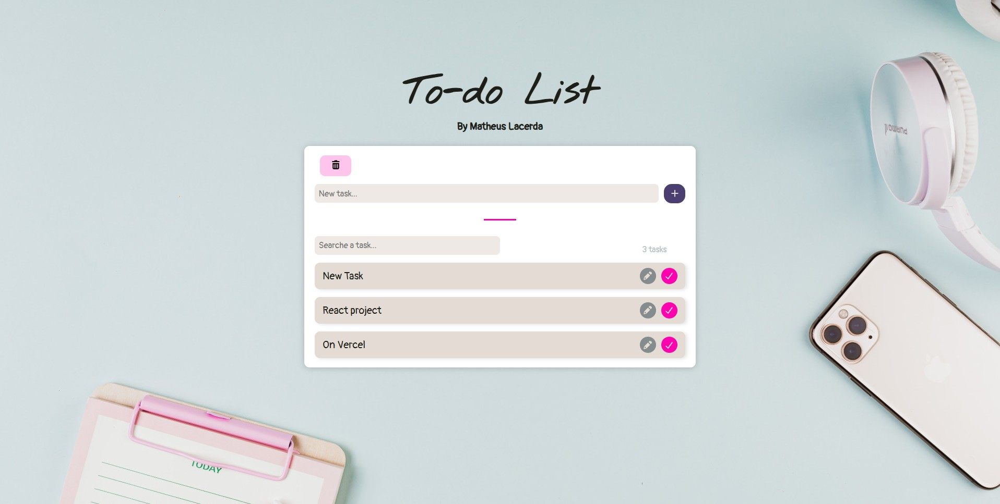
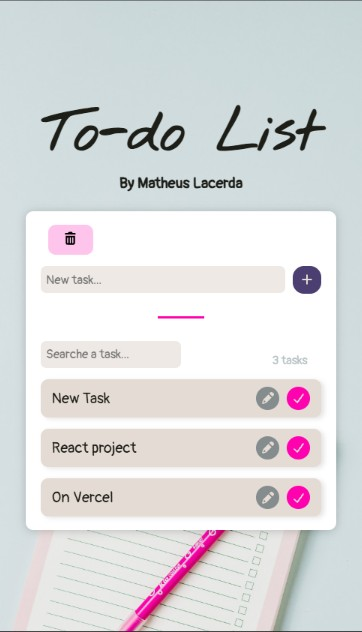

# **Todo List**

## **Overview**

This project is a task management application developed with React, focused on practicing component-based architecture, state management and data persistence.

The application allows users to create, edit, complete, search, delete and recover tasks, with data persistence using localStorage.

The project was developed to strengthen my understanding of React fundamentals, including useState, useEffect and componentization.

## **Screenshots**

### **Desktop**

### **Mobile**

## **Features**

* Create, edit and complete tasks
* Search tasks
* Task counter
* Completed tasks management
* Task recovery from trash
* Data persistence using localStorage
* Responsive design for desktop and mobile
* Component-based architecture with React

## **Technologies**

* React
* JavaScript (ES6+)
* CSS3
* localStorage
* Font Awesome
* React Toastify
* Google Fonts

## **Live Demo**

Vercel

https://todo-list-react-three-khaki.vercel.app/

